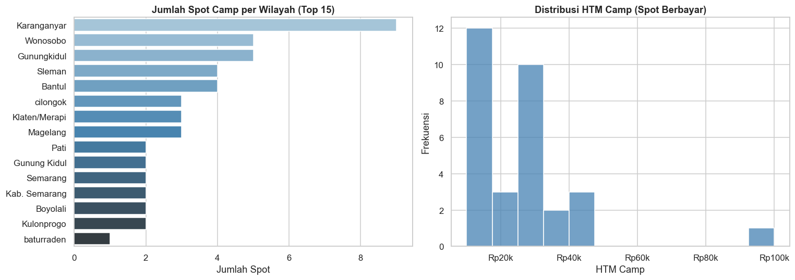
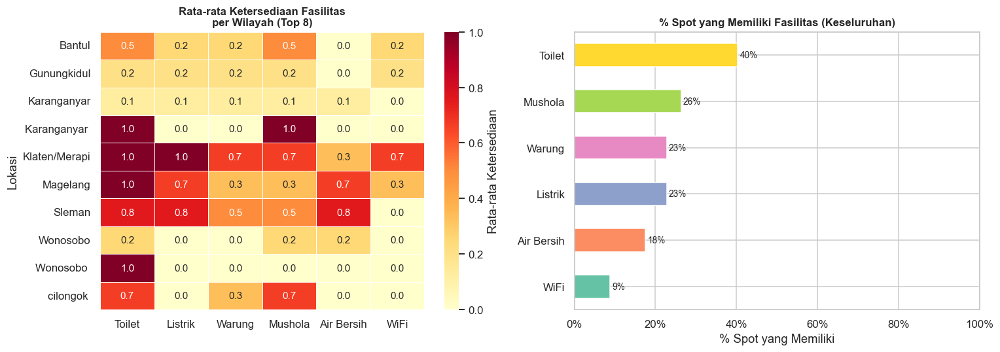
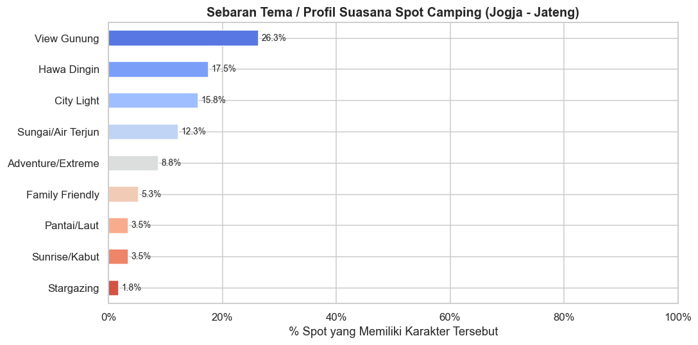
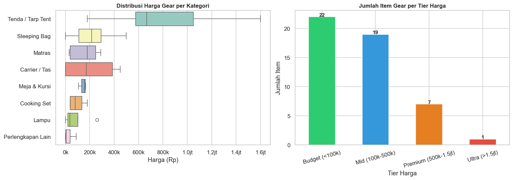
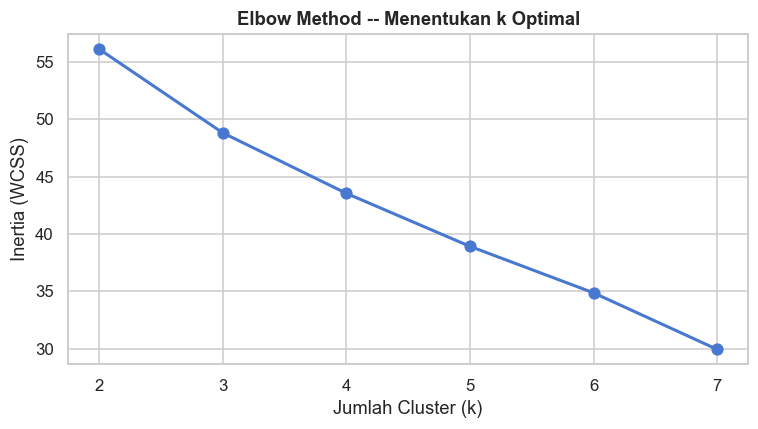
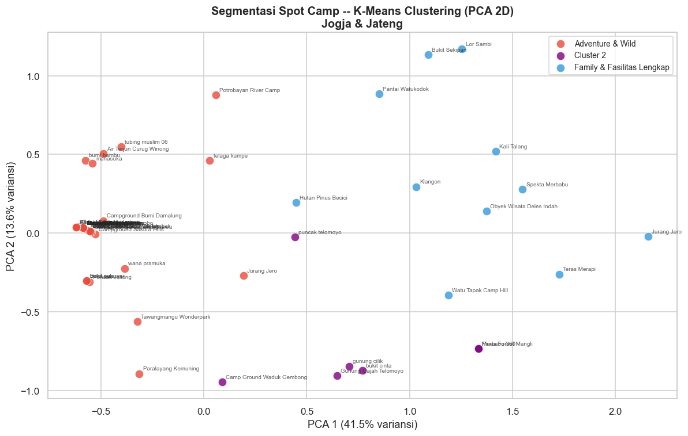

# 🏕️ Laporan Analisis & Dokumentasi Proyek: YuruCamp Data Science
## Smart Camping Planner & Budget Recommender (Jogja - Jateng)

---

## 📌 1. Pendahuluan & Latar Belakang

Proyek **YuruCamp Data Science** bertujuan untuk membangun sistem analitik terpadu dan mesin rekomendasi cerdas yang menghubungkan **destinasi perkemahan (*supply side*)** di wilayah Daerah Istimewa Yogyakarta dan Jawa Tengah dengan **katalog perlengkapan camping (*demand/preparation side*)**.

### Rumusan Masalah:
1. **Heterogenitas Lokasi:** Karakteristik lokasi camping di Jogja-Jateng sangat beragam (gunung berhawa dingin, pantai berangin, tepian sungai, hingga perkemahan keluarga ramah anak). Kebutuhan fasilitas dan risikonya berbeda drastis.
2. **Asimetri Informasi Biaya & Fasilitas:** Banyak tempat belum memiliki standardisasi tarif masuk, dan ketersediaan fasilitas vital (air bersih, listrik, toilet) bervariasi.
3. **Kesesuaian Gear & Anggaran:** Wisatawan seringkali kebingungan memilih peralatan yang tepat sesuai kondisi medan dan batas anggaran yang dimiliki.

---

## 🛠️ 2. Pipeline Pengolahan Data & Preprocessing

```
[Raw Data Sheets]
  ├── Database Camp Area (Jogja-Jateng) [Header di Baris 5, 57 Baris]
  └── Database Gear Recommendation [Format 2-Kolom Berdampingan, 49 Item]
          │
          ▼
[Data Cleaning & Regex Standardization]
  ├── HTM String ('Rp15.000,-', 'gratis', '10. 000') ➔ Numeric Float
  ├── Gear Price ('1.5 - 1.7 jt', '400k - 600k', '750k') ➔ Normalized Float
  └── Reshaping Gear: Multi-blok spreadsheet ➔ 1 Master Table Terstruktur
          │
          ▼
[Feature Engineering (NLP Keyword Extraction)]
  ├── Ekstraksi Fasilitas: Ada_Toilet, Ada_Listrik, Ada_Warung, Ada_Mushola, Ada_Air, Ada_Wifi
  └── Ekstraksi Suasana: View_Gunung, Sunrise, Citylight, Pantai, Sungai, Dingin, Family, Adventure
          │
          ▼
[Modeling & Segmentasi]
  ├── Normalisasi Fitur (MinMaxScaler)
  ├── Elbow Method & K-Means Clustering (k=3)
  └── Visualisasi 2D dengan Principal Component Analysis (PCA)
          │
          ▼
[Smart Recommendation Engine]
  └── Rule-based & Content-based matching (Kondisi Tempat ➔ Checklist Gear ➔ Optimasi Anggaran)
```

---

## 📊 3. Hasil Exploratory Data Analysis (EDA)

### 3.1. Persebaran Wilayah & Distribusi HTM Camp



#### Temuan Utama:
- **Konsentrasi Wilayah:** Wilayah dengan konsentrasi spot camping tertinggi adalah **Karanganyar (9 spot)**, diikuti oleh **Wonosobo (6 spot)**, **Gunungkidul (7 spot gabungan)**, **Sleman (4 spot)**, dan **Bantul (4 spot)**. Area lereng Gunung Lawu (Karanganyar) dan dataran tinggi Dieng (Wonosobo) menjadi episentrum camping dataran tinggi.
- **Distribusi Tarif Masuk (HTM):**
  - **Median HTM:** Rp 25.000 / orang.
  - **Rata-rata HTM:** Rp 25.387 / orang.
  - **Rentang Tarif:** Mulai dari gratis (Rp 0 / seikhlasnya) hingga Rp 100.000 (spot *family/glamping resort* seperti Pinea Forest Mangli).
  - Mayoritas spot ramah di kantong dengan tarif di bawah Rp 35.000.

---

### 3.2. Evaluasi Ketersediaan Fasilitas



#### Temuan Utama:
- **Kelengkapan Fasilitas Keseluruhan:**
  - **Toilet:** 40.4% spot tercatat memiliki toilet.
  - **Mushola:** 26.3% spot.
  - **Akses Listrik:** 22.8% spot (bisa berupa colokan di pohon atau rol ke tenda).
  - **Warung Makan:** 22.8% spot.
  - **Air Bersih Terjamin:** 17.5% spot.
  - **WiFi Publik:** 8.8% spot.
- **Pola Fasilitas per Wilayah:** 
  - Wilayah **Sleman** dan **Bantul** memiliki indeks ketersediaan fasilitas tertinggi (kebanyakan bertipe perkemahan terkelola/semi-glamping).
  - Wilayah perbukitan terpencil atau tepian pantai alami memiliki ketersediaan fasilitas terendah, menuntut persiapan mandiri (*survival gear*).

---

### 3.3. Karakteristik & Tag Suasana Spot



#### Temuan Utama:
- **Pemandangan Gunung (26.3%)** dan **Hawa Dingin Pegunungan (17.5%)** adalah daya tarik paling dominan di kawasan Jogja-Jateng (Merapi, Merbabu, Lawu, Sindoro, Sumbing).
- **Pemandangan City Light (15.8%)** menjadi tren populer untuk camping santai malam hari di area ketinggian sedang (Becici, Paralayang Kemuning, Watu Tapak).
- **Sungai & Curug (12.3%)** menawarkan suasana gemercik air, namun membutuhkan kehati-hatian terhadap risiko debit air mendadak saat hujan.
- **Stargazing (1.8%)** dan **Pantai (3.5%)** masih merupakan segmen ceruk (*niche*) yang belum banyak terinventarisasi secara terperinci.

---

### 3.4. Profiling Katalog Perlengkapan (Gear) & Anggaran



#### Statistik Harga per Kategori Perlengkapan:
| Kategori Peralatan | Jumlah Item | Harga Minimum | Harga Median | Harga Maksimum | Catatan Teknis Material |
| :--- | :---: | :---: | :---: | :---: | :--- |
| **Tenda / Tarp Tent** | 10 item | Rp 180.000 | **Rp 667.000** | Rp 1.600.000 | Rentang dari Flysheet ekonomis hingga Tenda Frame Alloy Ultralight (Nylon 20D) |
| **Sleeping Bag** | 5 item | Rp 94.000 | **Rp 270.000** | Rp 500.000 | Mulai dari dacron sintetis hingga bulu angsa (*down jacket/bag*) untuk suhu ekstrem |
| **Matras** | 5 item | Rp 30.000 | **Rp 180.000** | Rp 290.000 | Matras karet spon (Rp 30k) vs Matras angin insulasi (Rp 250k–290k) |
| **Cooking Set & Kompor** | 8 item | Rp 39.000 | **Rp 80.000** | Rp 180.000 | Kompor canister ultralight titanium (25 gr) vs nesting alumunium standar |
| **Carrier / Tas** | 6 item | Rp 200.000 | **Rp 375.000** | Rp 454.000 | Kapasitas 25L – 60L semi-ultralight lokal |
| **Meja & Kursi Lipat** | 3 item | Rp 108.000 | **Rp 159.000** | Rp 166.000 | Rangka alloy & oxford fabric untuk camping santai |
| **Lampu Penerangan** | 4 item | Rp 25.000 | **Rp 95.000** | Rp 260.000 | Lampu bakpao mini vs Lentera gantung rechargeable multi-mode |

---

## 🤖 4. Segmentasi Destinasi Menggunakan Machine Learning

### 4.1. Evaluasi Jumlah Klaster Optimal (Elbow Method)



Berdasarkan grafik penurunan *Inertia / Within-Cluster Sum of Squares (WCSS)*, titik transisi perubahan kelengkungan (*elbow point*) terbentuk secara optimal pada **$k = 3$**.

---

### 4.2. Karakteristik Persona Klaster ($k = 3$)

Model membagi seluruh destinasi ke dalam 3 persona spesifik:

```
                          [Hasil K-Means Clustering]
                                     │
         ┌───────────────────────────┼───────────────────────────┐
         ▼                           ▼                           ▼
[Family & Fasilitas Lengkap]  [Adventure & Wild]           [Scenic Premium]
  • 11 Spot (19.3%)             • 39 Spot (68.4%)            • 7 Spot (12.3%)
  • Rata-rata 4.55 fasilitas    • Fasilitas minim (0-1)      • 100% View Gunung
  • Listrik & WiFi tersedia     • Alami / semi-ekstrem       • 86% Hawa Dingin
  • HTM: ~Rp 33.800             • HTM: Rp 0 - Rp 15.000      • HTM: ~Rp 53.000
```

1. **Klaster 1: Family & Fasilitas Lengkap (11 Spot)**
   - *Karakter:* Ramah pemula dan keluarga, kavling tertata, ketersediaan stopkontak listrik, air bersih melimpah, dan toilet terawat.
   - *Contoh Spot:* Hutan Pinus Becici, Pantai Watukodok, Bukit Sekipan, Kali Talang, Teras Merapi.
2. **Klaster 2: Adventure & Wild (39 Spot)**
   - *Karakter:* Spot alami minim sentuhan modernisasi, akses jalur menantang, tanpa fasilitas listrik/air tetap. Sangat diminati kalangan backpacker dan pegiat *bushcraft/ultralight*.
   - *Contoh Spot:* Potrobayan River Camp, Watu Mabur Mangunan, Campground Merbabu, Bukit Jerit.
3. **Klaster 3: Scenic Premium (7 Spot)**
   - *Karakter:* Spot bertarif menengah ke atas dengan keunggulan panorama lanskap 360 derajat pegunungan megah dan udara dingin subtropis.
   - *Contoh Spot:* Pinea Forest Mangli, Merbabu 360, Gunung Gajah Telomoyo, Spekta Merbabu.

---

### 4.3. Visualisasi Sebaran Klaster dengan PCA (Principal Component Analysis)



Reduksi dimensi dari 14 fitur menjadi 2 komponen utama (PCA 1 dan PCA 2) membuktikan pemisahan klaster yang jelas:
- Sumbu horizontal (PCA 1) merepresentasikan **tingkat kelengkapan fasilitas dan modernisasi spot**.
- Sumbu vertikal (PCA 2) merepresentasikan **ketinggian, iklim dingin, dan panorama pegunungan**.

---

## 💡 5. Implementasi Mesin Rekomendasi: `camping_planner()`

Fungsi pintar `camping_planner()` yang diimplementasikan di `main.ipynb` menerapkan alur logika sebagai berikut:

```python
camping_planner(
    preferensi_lokasi='',                      # Filter Kabupaten/Kota
    preferensi_suasana=['view_gunung', 'dingin'], # Profil suasana yang dicari
    butuh_listrik=False,                       # Kebutuhan stopkontak
    butuh_wifi=False,                          # Kebutuhan internet
    budget_tiket=30_000,                       # Anggaran tiket (HTM + Parkir)
    budget_gear=1_500_000,                     # Anggaran belanja peralatan
    top_n=3                                    # Jumlah rekomendasi destinasi
)
```

### Simulasi Hasil Eksekusi (Contoh Kasus Pegunungan):
```
=================================================================
  🏕️  YURUCAMP — SMART CAMPING PLANNER RESULTS
=================================================================
  Preferensi   : ['view_gunung', 'sunrise', 'dingin']
  Budget Tiket : Rp 30.000/orang | Budget Gear : Rp 1.500.000
=================================================================

##################################################
  🏆 Rank #1: Jurang Jero (Magelang)
  📍 Lokasi     : Magelang
  💰 HTM Total  : Rp 25.000/orang
  🏷️ Tipe Camp  : Family & Fasilitas Lengkap
  ✨ Spot Keren : kaki gunung merapi sebelah barat, taman nasional
  🔧 Fasilitas  : toilet, air bersih, wifi, listrik, asuransi, warung 20 jam
  🗺️ Maps       : https://maps.app.goo.gl/KsmupztSNW6eMdfJ7

##################################################
  🏆 Rank #2: Teras Merapi (Sleman)
  📍 Lokasi     : Sleman
  💰 HTM Total  : Rp 20.000/orang
  🏷️ Tipe Camp  : Family & Fasilitas Lengkap
  ✨ Spot Keren : view puncak merapi jarak 5 km, malam melihat guguran lava
  🔧 Fasilitas  : toilet, mushola, warung, listrik, air bersih, kolam renang
  🗺️ Maps       : https://maps.app.goo.gl/Uu9FRDf1rfgTZhi56

=================================================================
  🎒  REKOMENDASI PAKET GEAR (Budget-Aware)
=================================================================
  Tenda              -> Decathlon MH100                 Rp   500.000  [Mid (100k-500k)]
  Sleeping Bag       -> Baseking Bulang (Bulu Angsa)    Rp   500.000  [Mid (100k-500k)]
  Matras             -> Matras Angin Venturis           Rp   250.000  [Mid (100k-500k)]
  Cooking Set        -> Nesting DS101                   Rp    95.000  [Budget (<100k)]
  Lampu Lentera      -> Lentera Rechargeable (est.)     Rp    50.000  [Budget (<100k)]
  Carrier (est.)     -> Reptil Adventure 45L            Rp   450.000  [Mid (100k-500k)]
-----------------------------------------------------------------
  TOTAL ESTIMASI GEAR                                  Rp 1.845.000
  HTM CAMP (1 Malam)                                   Rp    20.000
=================================================================
  GRAND TOTAL ESTIMASI                                 Rp 1.865.000
=================================================================
  ⚠️  Melebihi budget gear Rp 345.000. 
      Saran: Sewa Sleeping Bag Bulang atau gunakan Carrier yang sudah ada!
```

---

## 📈 6. Nilai Praktis & Roadmap Pengembangan Portofolio

### A. Nilai Bisnis & Penerapan Nyata:
1. **Bagi Pengelola Wisata & Pemda:** Mengetahui bahwa penyediaan fasilitas dasar (terutama toilet bersih dan titik listrik) mampu meningkatkan daya tarik spot dan menjustifikasi kenaikan HTM secara wajar.
2. **Bagi Pelaku Usaha Outdoor / Rental Gear:** Dapat membuat sistem paket bundling sewa alat berdasarkan destinasi tujuan konsumen (misal: *Paket Camping Lawu Dingin*, *Paket Ceria Lembah Merapi*).

### B. Langkah Pengembangan Selanjutnya (Next Steps):
1. **Interactive Web App (Deployment):** Mengemas logika notebook ini ke dalam dashboard web interaktif menggunakan framework **Streamlit** agar bisa dicoba langsung oleh masyarakat umum.
2. **Data Scraping & Enrichment:** Mengintegrasikan koordinat lintang-bujur (*latitude/longitude*) presisi, data elevasi mdpl dari DEM/Open-Elevation API, serta *live rating* ulasan Google Maps.
3. **Advanced Optimization (Knapsack Multi-Constraint):** Mengembangkan algoritma pemilihan perlengkapan yang tidak hanya membatasi total biaya, tetapi juga meminimalkan **total bobot bawaan (gram/kg)** untuk pendaki ultralight.

---
*Dokumentasi ini disusun sebagai bagian dari portofolio analisis data terintegrasi pada repositori YurucampDS.*
